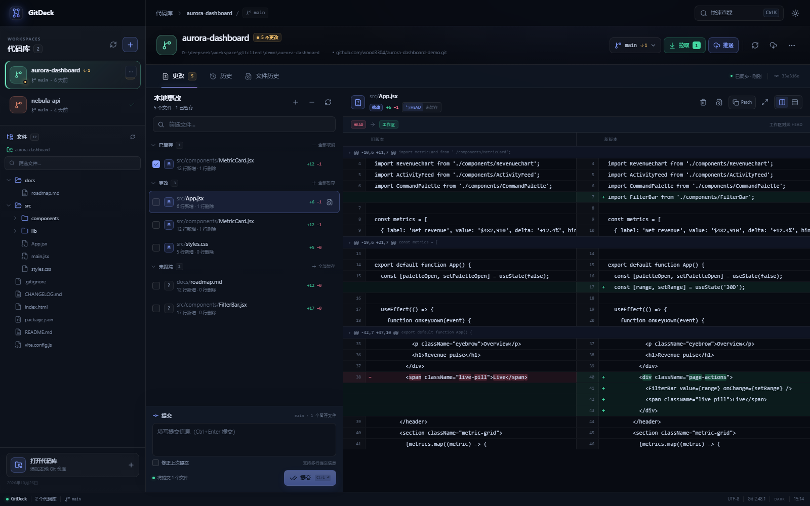
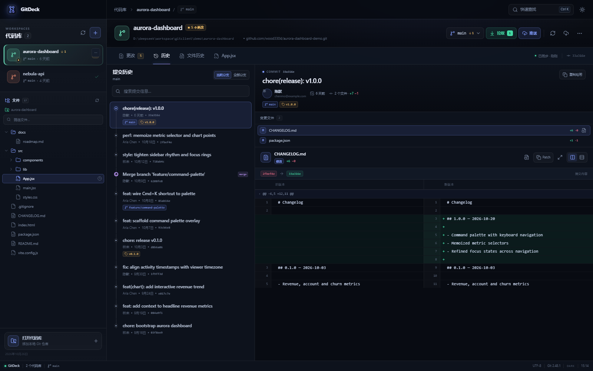
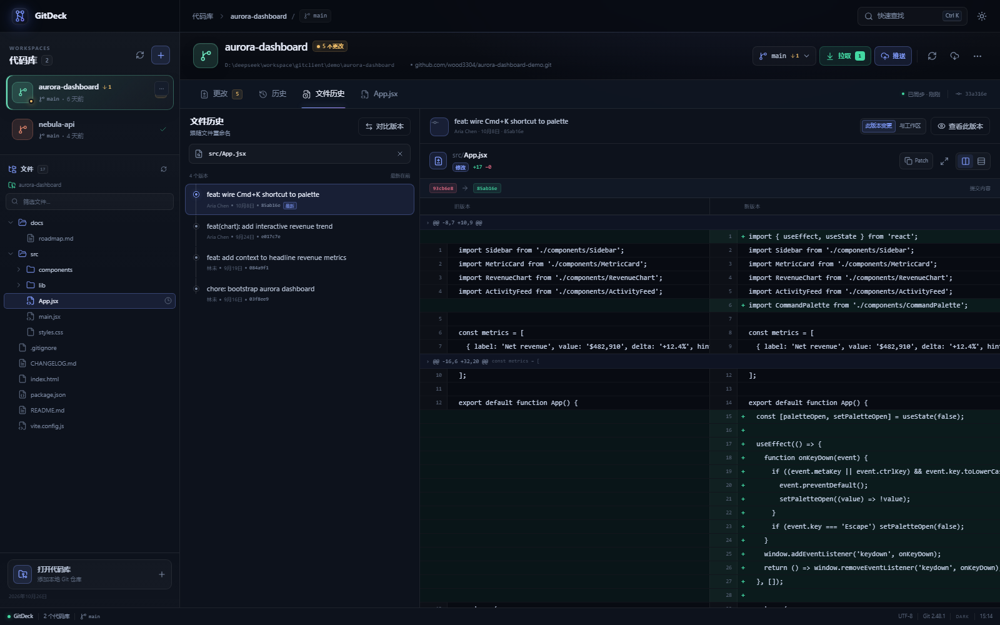
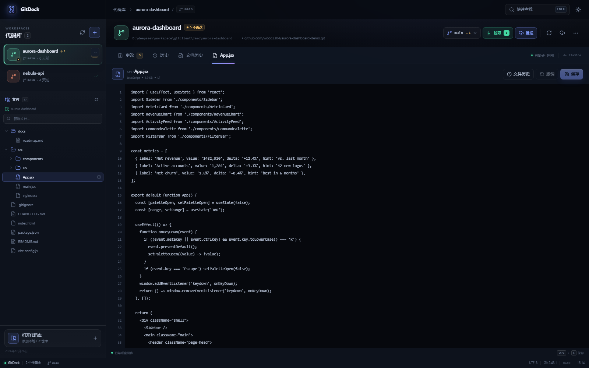
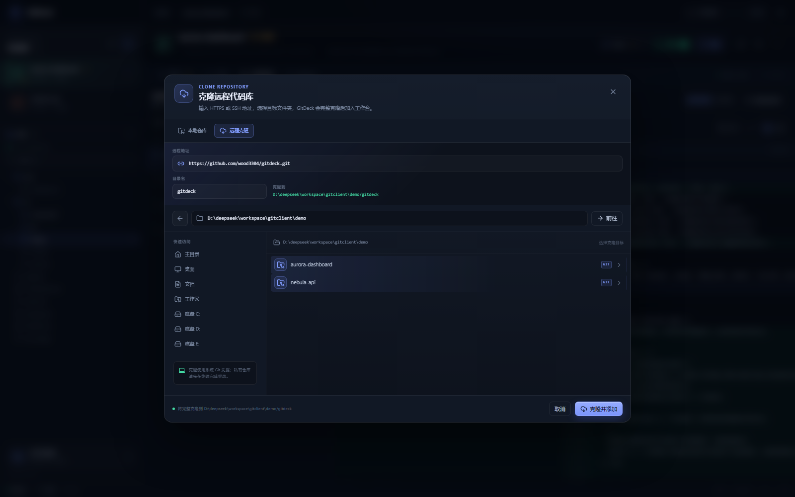
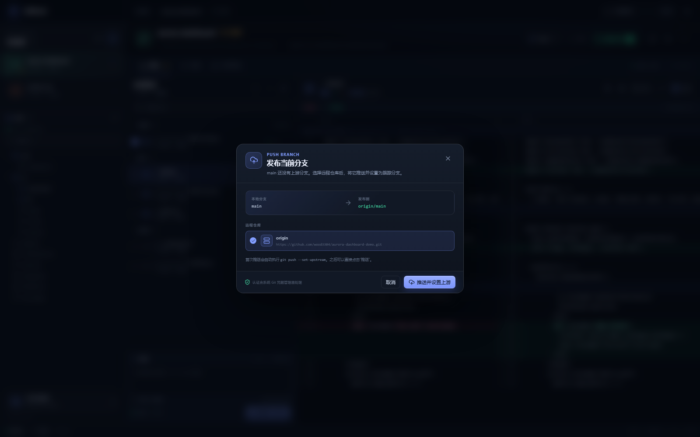
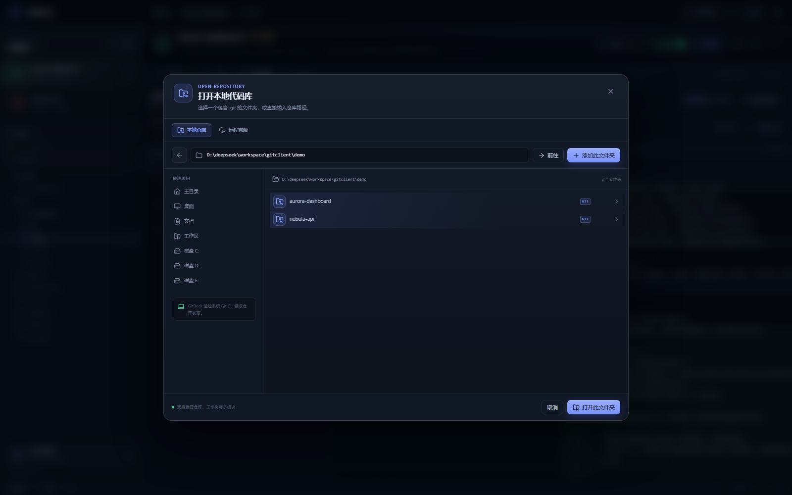
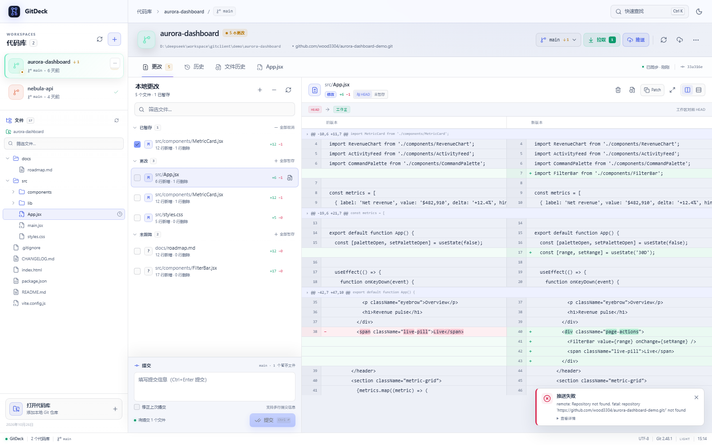

# GitDeck

> **多仓库 Git 工作台。**

[](https://github.com/wood3304/gitdeck/actions/workflows/ci.yml)
[](LICENSE)
[](https://nodejs.org/)
[](https://git-scm.com/)

GitDeck 是一个 Git 桌面客户端。它不接管你的 Git 工作流，而是通过系统 Git CLI 读取仓库状态，把多仓库、文件树、代码编辑、文件历史、提交记录和代码差异放进同一个界面。

GitDeck 通过系统 Git CLI 操作仓库；只有你主动执行 fetch、pull、push 或 clone 时才会访问远程。



---

## 目录

- [为什么是 GitDeck](#为什么是-gitdeck)
- [功能总览](#功能总览)
- [界面预览](#界面预览)
- [快速开始](#快速开始)
- [详细使用说明](#详细使用说明)
- [快捷键](#快捷键)
- [支持的 Git 操作](#支持的-git-操作)
- [技术架构](#技术架构)
- [API 概览](#api-概览)
- [数据、隐私与安全](#数据隐私与安全)
- [示例仓库](#示例仓库)
- [开发与测试](#开发与测试)
- [故障排查](#故障排查)
- [已知限制与路线图](#已知限制与路线图)
- [贡献](#贡献)
- [License](#license)

---

## 为什么是 GitDeck

Git 的日常使用通常分成三件事：

1. **我现在改了什么？** —— 工作区和代码库的差异。
2. **这段代码是怎么变成现在这样的？** —— 提交历史和文件历史。
3. **这个文件在某个版本里长什么样？** —— 历史版本快照和版本对比。

GitDeck 把这三件事做成一个连续的工作流：左侧管理多个仓库和文件树，中间浏览文件或提交，右侧是编辑器或当前上下文的 Diff。无须在命令行、编辑器和网页之间切换。

它不是 GitHub Desktop 的替代品，也不是完整的 Git 图形化客户端。它更接近一个 **本地代码考古与 review 工作台**：

- 优先展示读得懂的历史和差异；
- 对多仓库项目友好；
- 对写操作保持克制，并且每一步都可见。

## 功能总览

### 多代码库工作台

- 左侧代码库列表集中管理任意数量的本地 Git 仓库。
- 显示当前分支、未提交更改数量、领先/落后上游提交数、最近提交时间。
- 一键刷新所有仓库；双击仓库卡片在系统文件管理器中打开。
- 支持从列表移除仓库，不会删除磁盘上的任何文件。
- 仓库不可用时标记为「不可用」，不会影响其他仓库。

### 文件目录与编辑器

- 左侧文件树按层级展示当前仓库的目录结构。
- 文件树基于 Git 索引与未跟踪文件构建，自动排除 `.gitignore` 忽略的内容。
- 支持目录展开/收起、文件筛选和「只看匹配文件」搜索。
- 文件行悬停可一键打开该文件的文件历史。
- 选中文件后新增「文件」标签，在右侧直接查看和编辑文本。
- 编辑器带行号、行尾格式提示、未保存状态、`Ctrl/Cmd+S` 保存、撤销和重新读取。
- 保留原文件 LF / CRLF 行尾格式；文件超过 2 MB 或为二进制时自动只读。
- 未保存内容会写入当前浏览器会话的草稿，切换标签或文件后可恢复。
- 保存后自动刷新文件状态、文件树和仓库摘要；仍需要像平常一样暂存并提交。

### 远程代码库导入

- 在「打开代码库」弹窗中切换「远程克隆」。
- 支持 HTTPS、SSH、`git://` 和 `file://` 地址；也可以直接粘贴 `github.com/user/repo`。
- 选择目标文件夹和目录名，执行完整的 `git clone`（保留提交历史，支持文件历史）。
- 克隆成功后自动加入工作台并切换过去。
- 使用系统 Git / Git Credential Manager 进行认证，不会在 GitDeck 中保存 Token。
- 目标目录已存在、URL 携带账号密码、认证失败等情况都会给出明确错误。

### 本地更改与提交

- 基于 `git status --porcelain=v2` 的文件状态，按「已暂存 / 更改 / 未跟踪 / 冲突」分组。
- 单文件、单组或全部暂存/取消暂存。
- 丢弃工作区或暂存区中的修改（带二次确认）。
- 提交信息支持多行；`Ctrl+Enter` 快速提交。
- 支持修正上一次提交（amend）。
- 提交后自动刷新文件状态、仓库计数和提交历史。

### Diff 阅读

- 工作区 ↔ HEAD、工作区 ↔ 暂存区、暂存区 ↔ HEAD 三种比较范围。
- 并排（split）和统一（unified）两种布局。
- 行级增删统计、Hunk 定位、行号对齐。
- 对成对的修改行进行词级高亮。
- 一键展开完整上下文，或复制原始 patch。
- 二进制文件、无变化、空文件均有明确状态提示。

### 提交历史

- 当前分支 / 全部分支视图。
- 按提交信息搜索。
- 展示分支、标签、远程引用、HEAD 和合并提交标记。
- 提交详情包含作者、提交时间、父提交、变更文件数、增删行数。
- 在提交详情中逐文件查看 Diff。
- 复制完整 commit hash。

### 文件历史

- 输入路径或搜索已跟踪文件。
- 使用 `git log --follow` 跟随文件重命名。
- 时间线展示该文件的每一个版本。
- 查看「此版本相对父提交」的差异。
- 切换为「此版本相对工作区当前文件」。
- 勾选任意两个版本进行对比。
- 查看某个历史版本的原始文件内容（快照），支持复制。
- 未跟踪文件、无历史文件、二进制文件都有对应空状态。

### 分支与远程

- 分支切换器：搜索、当前分支标记、最近提交信息。
- 新建分支（基于当前 HEAD）。
- 列出远程分支，并从远程分支创建本地跟踪分支。
- 获取远程更新：`git fetch --all --prune`。
- 拉取当前分支：显示落后提交数，执行 `git pull --ff-only`；分叉历史会明确报错，不会隐式 merge 或 rebase。
- 推送当前分支：已有上游时直接 `git push`；首次推送可选择远程仓库并自动设置上游分支。
- 推送前显示领先提交数，成功后自动刷新仓库状态。
- 不执行强制推送；非 fast-forward 时保留 Git 原始错误，交由你决定下一步。

### 使用体验

- 深浅两套主题。
- `Ctrl+K` 命令面板：切换仓库、跳转视图、打开代码库、刷新、切换主题。
- 自动记忆最近浏览路径和主题。
- 错误以 Toast 展示，可展开查看 Git 原始错误。
- Windows 一键启动脚本。
- 响应式布局，最小支持宽度约 780px。

## 界面预览

### 提交历史与提交详情



### 文件历史与版本对比



### 文件树与编辑器



### 克隆远程代码库



### 首次推送分支



### 打开本地代码库



### 浅色主题



## 快速开始

### 环境要求

- **Node.js >= 22**（推荐 Node.js 22 LTS 或更新版本）
- **Git >= 2.30**，同时需要 `git` 在 `PATH` 中可用
- Windows、macOS 或 Linux

> GitDeck 直接调用系统 Git CLI，不内置 Git 二进制，也不依赖 libgit2。

### Windows 一键启动

双击仓库根目录的 [`start.cmd`](start.cmd)。

脚本会：

1. 检查 Node.js 与 Git；
2. 缺依赖时执行 `npm install`；
3. 构建前端；
4. 启动本地服务，并尝试打开 <http://127.0.0.1:4788>。

### 手动启动

```bash
git clone https://github.com/wood3304/gitdeck.git
cd gitdeck
npm install
npm run build
npm start
```

打开 <http://127.0.0.1:4788>。

### 开发模式

```bash
npm install
npm run dev
```

`npm run dev` 使用 Vite 中间件模式，在同一个端口提供 API 和前端热更新。

### 自定义端口

```bash
# Windows PowerShell
$env:PORT=4789; npm start

# Windows CMD
set PORT=4789 && npm start

# macOS / Linux
PORT=4789 npm start
```

## 详细使用说明

完整的分步操作手册见 **[docs/USER_GUIDE.md](docs/USER_GUIDE.md)**，包含界面区域说明、典型工作流、Diff 模式选择、版本对比和常见问题。

下面是快速导览。

### 1. 添加代码库

点击左下角「打开代码库」、左上角 `+`，或按 `Ctrl+O`。

弹窗提供两种方式：

**本地仓库**

- 可以直接输入本地路径；
- 也可以通过内置目录浏览器选择；
- Git 仓库会被标记为 `GIT`；
- 选择仓库内的任意子目录也可以，GitDeck 会自动解析到 Git 根目录。

**远程克隆**

- 切换到「远程克隆」；
- 输入 HTTPS / SSH 地址，例如 `https://github.com/user/repo.git` 或 `git@github.com:user/repo.git`；
- 选择目标文件夹，确认目录名；
- 点击「克隆并添加」，GitDeck 会执行完整的 `git clone`，完成后自动加入工作台。

选择或克隆完成后，仓库会出现在左侧列表，并自动切换到该仓库。

### 2. 浏览文件目录与编辑文件

左侧代码库列表下方是当前仓库的文件树：

- 点击目录展开/收起；顶层目录默认展开；
- 顶部筛选框按路径或文件名过滤；
- 文件行右侧的时钟图标直接打开该文件的文件历史；
- 点击文件，在右侧新增的「文件」标签中打开。

编辑器支持：

- 行号、语言、大小、LF/CRLF 提示；
- 直接修改文本，`Ctrl/Cmd+S` 保存；
- 保存前有「未保存」标记，标签页显示黄色圆点；
- 「撤销」放弃修改；
- 文件被外部修改时拒绝覆盖，并提供「重新读取」；
- 未保存内容按文件保存在当前浏览器会话，切换标签后可恢复；
- 超过 2 MB 或二进制文件自动只读。

保存只是写入工作区，不会自动暂存或提交。保存后到「更改」中暂存，再提交即可。

### 3. 查看工作区更改

点击「更改」标签：

- 已暂存的文件显示在「已暂存」；
- 已修改但未暂存的文件显示在「更改」；
- 新文件显示在「未跟踪」；
- 冲突文件单独显示，并提示先解决冲突。

点击文件行，右侧显示 Diff。勾选文件左侧的方框可以暂存；再次点击可以取消暂存。

### 4. 比较当前文件与代码库

选中文件后，右侧顶部的模式标签允许切换：

| 模式 | 含义 |
| --- | --- |
| 与 HEAD | 当前工作区（包括已暂存和未暂存）相对 HEAD |
| 未暂存 | 工作区相对暂存区 |
| 已暂存 | 暂存区相对 HEAD |
| 未跟踪 | 未跟踪文件相对空文件 |

使用右上角的并排/统一按钮切换布局，使用展开图标查看完整上下文。

### 5. 提交

在左侧底部填写提交信息，点击「提交」或按 `Ctrl+Enter`。

- 只有已暂存文件会被提交；
- 勾选「修正上次提交」可执行 `git commit --amend`；
- 提交失败时，Git stderr 会完整展示，便于排查钩子、用户信息或冲突问题。

### 6. 浏览提交历史

点击「历史」标签：

- 默认查看当前分支；切换为「全部分支」可以看到其他分支的提交；
- 顶部搜索框按提交信息过滤；
- 点击提交查看详情和文件列表；
- 点击文件列表中的文件查看该提交对这个文件的改动；
- 点击文件行右侧的时钟图标可直接跳到该文件的文件历史。

### 7. 查看文件历史

点击「文件历史」，输入路径或从搜索建议中选择文件。

- 时间线按「最新在前」排列；
- 点击任意版本查看该提交引入的改动；
- 切换「与工作区」查看历史版本和当前工作区文件之间的累计差异；
- 点击「查看此版本」打开历史文件快照。

### 8. 比较两个版本

1. 在文件历史中点击「对比版本」；
2. 勾选两个版本；
3. 右侧自动比较较旧版本 → 较新版本；
4. 可继续切换不同版本；点击「退出对比」返回单个版本模式。

### 9. 分支操作

点击仓库标题右侧的分支按钮：

- 搜索并切换本地分支；
- 新建分支；
- 从远程分支创建本地跟踪分支。

切换分支前请确保工作区没有会冲突的修改，否则 Git 会拒绝操作并显示原因。

### 10. 获取远程更新

点击仓库标题右侧的云下载图标，执行：

```bash
git fetch --all --prune
```

GitDeck 不会自动 merge 或 rebase。

### 11. 拉取当前分支

仓库标题右侧的「拉取」按钮会显示当前分支落后上游的提交数：

- 点击执行 `git pull --ff-only`，只允许 fast-forward；
- 拉取成功后自动刷新工作区、仓库摘要和分支状态；
- 工作区有冲突修改、历史分叉或认证失败时，保留 Git 原始错误；
- GitDeck 不会自动 merge 或 rebase，也不会产生隐式合并提交；
- 当前分支没有上游时按钮不可用，请先「发布分支」设置上游。

### 12. 推送当前分支

仓库标题右侧的「推送」按钮会显示当前分支领先上游的提交数：

- **已有上游分支**：点击后执行 `git push`；
- **首次推送**：按钮显示为「发布分支」。点击后选择远程仓库，GitDeck 会执行 `git push --set-upstream <remote> <branch>` 并自动建立跟踪关系；
- 推送成功后自动刷新仓库摘要和分支状态；
- 推送失败时保留 Git 原始错误。GitDeck 不会自动 force push；
- 认证由系统 Git / Git Credential Manager 处理。

## 快捷键

| 快捷键 | 操作 |
| --- | --- |
| `Ctrl+K` | 打开命令面板 |
| `Ctrl+O` | 打开 / 克隆代码库 |
| `Ctrl+Enter` | 在提交信息框中提交 |
| `Ctrl/Cmd+S` | 保存当前编辑器文件 |
| `Esc` | 关闭命令面板或弹窗 |

## 支持的 Git 操作

| 分类 | 操作 | 状态 |
| --- | --- | --- |
| 读取 | 仓库摘要、分支、状态、提交历史 | ✅ |
| 读取 | 文件树、工作区文件内容 | ✅ |
| 读取 | 工作区 / 暂存区 / 提交 / 版本间 Diff | ✅ |
| 读取 | 文件历史、重命名跟随、历史文件内容 | ✅ |
| 写入 | 直接编辑并保存工作区文件（不自动暂存） | ✅ |
| 写入 | 暂存、取消暂存、丢弃修改 | ✅ |
| 写入 | 提交与 amend | ✅ |
| 写入 | 切换分支、新建分支、跟踪远程分支 | ✅ |
| 网络 | `git fetch --all --prune` | ✅ |
| 网络 | `git pull --ff-only`（仅快进） | ✅ |
| 网络 | `git push`（含首次设置上游） | ✅ |
| 仓库 | `git clone`（HTTPS / SSH / Git 协议） | ✅ |
| 历史编辑 | rebase、cherry-pick、revert、merge、stash | ❌ 未实现 |
| 暂存粒度 | 按 hunk / 行暂存 | ❌ 未实现 |
| 冲突 | 内建三方合并编辑器 | ❌ 未实现 |
| LFS | Git LFS 专用管理界面 | ❌ 未实现 |

## 技术架构

```
浏览器 (React 19 + Vite)
        │  fetch /api/*
        ▼
Express 5 (仅监听 127.0.0.1)
        │  spawn(git, args)
        ▼
系统 Git CLI
```

### 设计要点

- **无数据库**：仓库配置保存在 `.data/state.json`。
- **无 shell 拼接**：所有 Git 命令通过 `spawn` 调用参数数组，路径使用 `--literal-pathspecs`，避免命令注入和 glob 歧义。
- **结构化解析**：`git status --porcelain=v2 -z`、`git log` 自定义分隔符、统一 diff 解析器。
- **服务边界**：HTTP 服务只绑定 loopback，不发送遥测，不读取远程凭据。
- **跨平台**：Windows 下通过临时文件捕获 Git stdout/stderr，避免管道与编码问题；同时兼容 macOS / Linux。
- **无框架负担**：前端只依赖 React、Vite 和 `lucide-react` 图标库；后端只依赖 Express。

### 目录结构

```text
.
├── server/
│   ├── index.js          Express 路由、静态服务、开发模式
│   ├── git.js            Git CLI 调用与 status/log/diff 解析
│   ├── store.js          多仓库配置持久化
│   ├── fs-browser.js     本地目录浏览
│   └── errors.js         统一错误类型
├── src/
│   ├── App.jsx           工作台壳层、多仓库状态
│   ├── api.js            前端 API 客户端
│   ├── utils.js          日期、路径、状态映射等工具
│   ├── styles.css        设计系统与全局样式
│   └── components/
│       ├── ChangesView.jsx       本地更改
│       ├── HistoryView.jsx       提交历史
│       ├── FileHistoryView.jsx   文件历史与版本对比
│       ├── DiffViewer.jsx        Diff 渲染
│       ├── FileExplorer.jsx      左侧文件树
│       ├── FileEditorView.jsx    工作区文件查看/编辑
│       ├── RepoRail.jsx          左侧代码库列表
│       ├── Shell.jsx             顶栏、仓库头、标签栏、状态栏
│       ├── AddRepoModal.jsx      本地打开 + 远程克隆
│       ├── BranchMenu.jsx        分支菜单
│       ├── CommandPalette.jsx    命令面板
│       └── common.jsx            弹窗、Toast、空状态等
├── scripts/seed-demo.mjs 示例仓库生成器
├── tests/git.test.js     Git 后端集成测试
├── docs/                 使用手册与截图
├── start.cmd             Windows 一键启动
└── vite.config.js
```

## API 概览

服务默认运行在 `http://127.0.0.1:4788`，所有 API 位于 `/api` 下。

| Method | Path | 说明 |
| --- | --- | --- |
| GET | `/api/health` | 服务与 Git 版本 |
| GET | `/api/repos` | 仓库列表与摘要 |
| POST | `/api/repos` | 添加本地仓库 |
| POST | `/api/repos/clone` | 克隆远程仓库并加入工作台 |
| DELETE | `/api/repos/:id` | 移除仓库 |
| POST | `/api/repos/active` | 切换当前仓库 |
| GET | `/api/repos/:id/status` | 工作区状态 |
| GET | `/api/repos/:id/tree` | 文件树（索引 + 未跟踪、非忽略文件） |
| GET | `/api/repos/:id/working-file` | 读取工作区文件 |
| PUT | `/api/repos/:id/working-file` | 保存工作区文件 |
| GET | `/api/repos/:id/log` | 提交历史（支持 `q`、`all`、`path`、`skip`） |
| GET | `/api/repos/:id/commits/:hash` | 提交详情 |
| GET | `/api/repos/:id/diff` | 文件 Diff（`mode=worktree/staged/unstaged/untracked/commit/between`） |
| GET | `/api/repos/:id/file-history` | 文件版本历史 |
| GET | `/api/repos/:id/file-content` | 历史版本内容 |
| GET | `/api/repos/:id/files` | 已跟踪/未忽略文件搜索 |
| GET | `/api/repos/:id/branches` | 本地与远程分支 |
| POST | `/api/repos/:id/checkout` | 切换/创建分支 |
| POST | `/api/repos/:id/stage` | 暂存 |
| POST | `/api/repos/:id/unstage` | 取消暂存 |
| POST | `/api/repos/:id/discard` | 丢弃修改 |
| POST | `/api/repos/:id/commit` | 提交或 amend |
| POST | `/api/repos/:id/fetch` | 获取远程更新 |
| POST | `/api/repos/:id/pull` | 快进拉取当前分支 |
| POST | `/api/repos/:id/push` | 推送当前分支（可选设置上游） |
| POST | `/api/repos/:id/reveal` | 在文件管理器中打开 |
| GET | `/api/fs` | 浏览本地目录 |
| POST | `/api/scan` | 扫描子目录中的仓库 |

## 数据、隐私与安全

- 状态文件：`.data/state.json`，仅包含仓库绝对路径、添加时间和当前选中项。
- 服务监听：`127.0.0.1`，默认不对局域网开放。
- Git 凭据：由系统 Git / Git Credential Manager 管理，GitDeck 不读取、不存储 token。
- 遥测：无。
- 网络请求：GitDeck 自身不发起网络请求；只有你主动点击「获取远程更新」「拉取」「推送」或「克隆远程代码库」时，才会执行对应的 `git fetch` / `git pull` / `git push` / `git clone`。
- 文件编辑保护：只允许编辑代码库内的普通文本文件；拒绝 `.git` 路径、目录穿越和指向仓库外的符号链接，最大 2 MB。
- 删除保护：从工作台移除仓库不会删除磁盘目录；丢弃修改有明确确认弹窗。
- 安全边界：服务没有登录鉴权，只应在本机受信任环境中运行。不要把端口暴露到公网。

## 示例仓库

仓库不包含 `demo/` 目录（嵌套的 `.git` 无法直接提交到 Git）。可以随时用脚本现场生成两个带完整历史的示例仓库：

```bash
npm run seed -- --force
npm start
```

然后通过「打开代码库」添加：

- `demo/aurora-dashboard`
- `demo/nebula-api`

`--force` 会删除并重新生成这两个示例目录，请勿在已有自定义内容时使用。

生成脚本覆盖了：

- 多分支与合并提交；
- 标签；
- 已暂存 / 未暂存 / 未跟踪文件；
- 适合演示文件历史和版本对比的提交记录。

## 开发与测试

```bash
npm install       # 安装依赖
npm run dev       # 开发模式（Vite 中间件）
npm test          # Node 内置测试运行器
npm run build     # 生产构建
npm start         # 生产模式
```

测试覆盖：

- porcelain v2 状态解析；
- 仓库初始化、状态、工作区/暂存区 Diff；
- 暂存/取消暂存、提交、提交详情；
- 提交历史、文件历史、历史文件内容；
- 分支创建与切换；
- 丢弃修改。

CI 会在 push / pull request 时运行 `npm ci`、`npm test` 和 `npm run build`。

## 故障排查

### `GitDeck 尚未构建`

先执行：

```bash
npm run build
```

或直接使用 `start.cmd`，它会自动构建。

### 端口 4788 被占用

使用其他端口：

```bash
$env:PORT=4789; npm start
```

### 添加仓库时提示「不是 Git 代码库」

确认目录下存在 `.git`。如果选择的是仓库内的子目录，GitDeck 会自动解析到仓库根目录；裸仓库（bare repository）暂不支持。

### 看不到示例仓库

仓库不包含 `demo/`。先运行：

```bash
npm run seed -- --force
```

然后重新打开应用或点击「打开代码库」添加生成的目录。

### fetch 失败

GitDeck 禁用了交互式凭据提示。请先在终端确认：

```bash
git fetch --all
```

能在系统 Git 中成功执行后，再回到 GitDeck 点击获取远程更新。

### pull 失败

- **没有上游分支**：「拉取」按钮不可用；先推送当前分支并设置上游；
- **认证失败**：先在终端执行一次 `git pull`，让系统 Git 凭据管理器完成登录；
- **工作区有冲突修改**：先提交、暂存或丢弃修改；
- **分叉历史**：GitDeck 只做 fast-forward，不会自动 merge/rebase，请到终端处理。

### push 失败

- **没有远程仓库**：先在终端执行 `git remote add origin <url>`，再刷新仓库；
- **认证失败**：在终端执行一次 `git push`，让系统 Git 凭据管理器完成登录；
- **non-fast-forward**：远程存在本地没有的提交。GitDeck 不会强制推送，请先 fetch 并自行合并/变基；
- **detached HEAD**：先切换到一个本地分支再推送。

### 文件历史为空

- 确认文件已被 Git 跟踪；
- 未跟踪文件没有历史；
- 改名后的路径使用 `git log --follow` 追踪，但历史版本 Diff 仍以当前路径为准。

### 大文件或二进制文件

- 二进制文件只显示状态，不渲染文本 Diff；
- 历史文件快照最大读取 2 MB，超出部分会截断；
- 文件历史页面最多展示最近 80 个相关提交。

## 已知限制与路线图

当前版本聚焦 Git 工作流，因此有一些刻意保留的边界：

- `pull` 仅支持 fast-forward；分叉历史需要在终端合并或变基；
- 没有强制推送、标签推送、远程管理界面；
- 没有按 hunk 暂存、rebase/cherry-pick/revert、stash；
- 没有内建合并冲突解决器；
- 文件编辑是轻量文本编辑器：没有语法高亮、新建/重命名/删除文件，文件上限 2 MB；
- 克隆没有进度条、取消、浅克隆或稀疏检出；
- 没有 Git LFS 专用支持；
- 没有桌面安装包（当前通过 Web 服务运行）。

后续可以考虑：

- [ ] 按 hunk / 行暂存；
- [ ] pull 的 merge / rebase 策略；
- [ ] 文件新建 / 重命名 / 删除与语法高亮；
- [ ] 克隆进度、取消与浅克隆；
- [ ] 强制推送 / 标签推送与远程管理；
- [ ] 提交图（commit graph）视图；
- [ ] 冲突解决工作区；
- [ ] Electron / Tauri 桌面封装；
- [ ] Git LFS 状态与文件提示；
- [ ] 多窗口 / 工作区（workspace）概念。

## 贡献

欢迎提交 Issue 和 Pull Request。

1. Fork 仓库；
2. 创建功能分支：`git switch -c feature/your-feature`；
3. 修改代码并补充测试；
4. 确保 `npm test` 和 `npm run build` 通过；
5. 提交 PR，并描述改动动机和验证方式。

如果发现安全问题，请不要公开提交 Issue，先通过 GitHub 私下联系维护者。

## License

[MIT](LICENSE) © 2026 GitDeck
